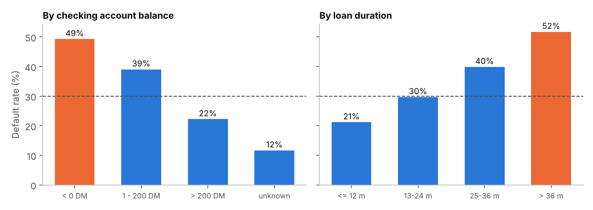
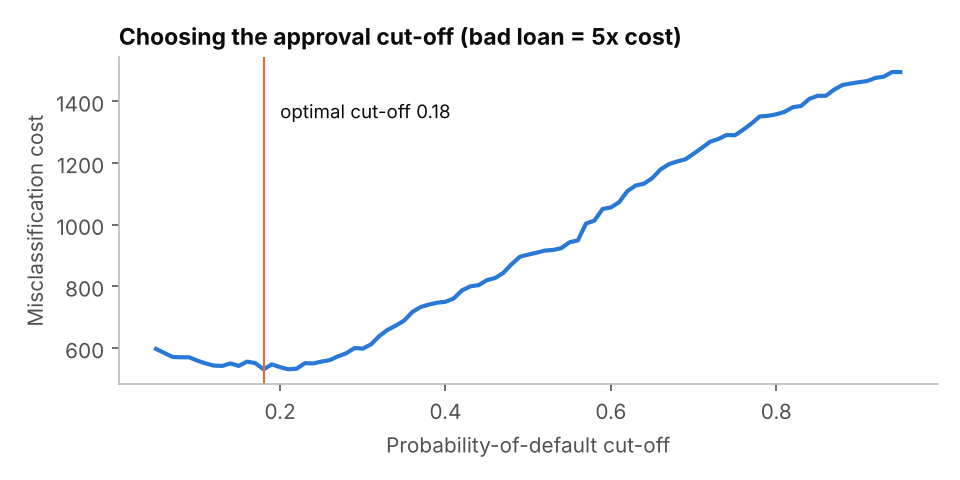
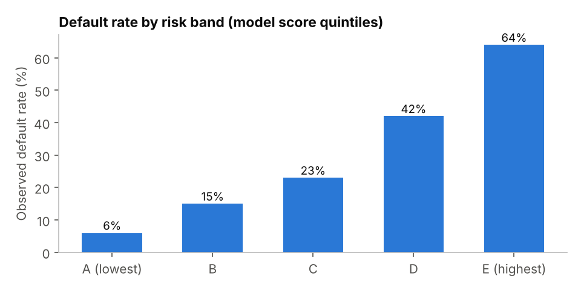

# Credit Risk Scoring with an Automated Data Quality Framework

Scoring loan applicants by probability of default, after passing the data through an automated, self-tested data quality framework.

**Tools:** Python · Pandas · Scikit-learn · Matplotlib
**Data:** German Credit dataset (UCI), 1,000 loans, 20 attributes, 30% defaults

## 1. Automated data quality checks
`run_quality_checks()` applies **34 rules** across five dimensions and returns a PASS / FAIL / REVIEW report (`outputs/data_quality_report.csv`):

| Dimension | Example rule |
|---|---|
| Completeness | every column not null |
| Validity | age in [18, 100], installment rate in [1, 4], categories in allowed list |
| Uniqueness | no duplicate records |
| Consistency | default flag is 0/1 |
| Outliers (review) | loan amount > Q3 + 3 x IQR |

**Result:** 33 checks pass. 24 unusually large loans are flagged for review, not deleted.
**Self-test:** the script injects 4 known errors (age = 150, a missing amount, an invalid category, a duplicate row) into a copy and asserts that every one is caught.

## 2. Who defaults?
- Negative checking balance: **49%** default rate, vs 12% when there is no checking account.
- Loans longer than 36 months: **52%**, vs 21% for loans of 12 months or less.



## 3. Scoring model
- Logistic regression evaluated with 5-fold stratified cross-validation: **ROC-AUC 0.786, Gini 0.573**.
- **Cost-sensitive cut-off:** approving a bad loan is assumed to cost 5x more than rejecting a good one. Moving the cut-off from 0.50 to **0.18** cuts total misclassification cost by **41%** and catches **86%** of defaulters.



## 4. Risk bands for portfolio monitoring
Applicants are split into 5 bands by score. Default rates rise steadily from band A to E, which confirms the score ranks risk correctly:

| Band | A | B | C | D | E |
|---|---|---|---|---|---|
| Default rate | 6% | 15% | 23% | 42% | 64% |



## Run it
```bash
pip install pandas scikit-learn matplotlib
python credit_risk_analysis.py
```
